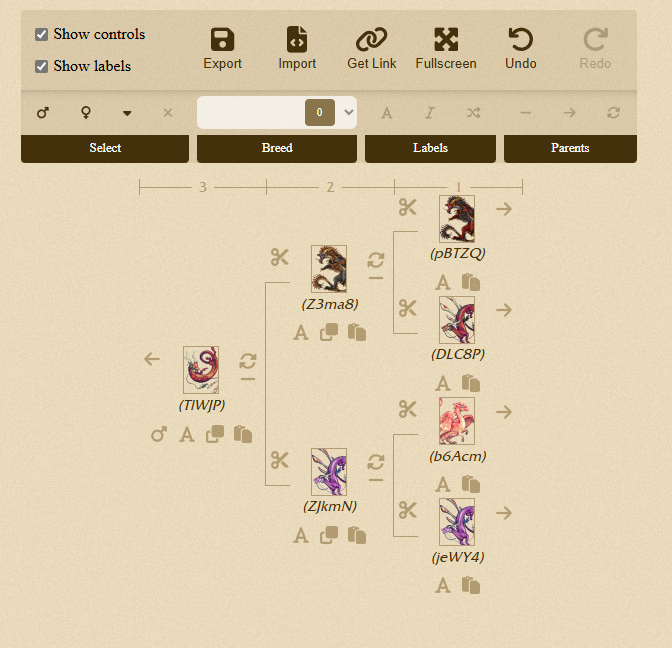

# DragCave Lineage Builder

DragCave lineage builder is an open-source third-party utility for the online game [dragcave.net](https://dragcave.net/). It enables users to preview dragon lineages, a core function of the game.

Written in TypeScript with Nuxt 4 (server-rendered Vue 3 frontend and Nitro API routes) and MySQL/MariaDB.



## Features

- Looks nearly the same as DC! This tool aims to replicate how a lineage is displayed on DC right down to the very last pixel. ;)
- "Fully granular" control over dragons - you can clone and paste entire ancestors, switch parent genders, remove/add ancestors and descendants.
- Automatic code and name generation!
- Code and name validation - All codes and names are validated to ensure they are legal on DC (but will not be checked for availability.) A game changer for you lyrical lineage builders out there.
- Share publicly viewable links to built lineages.
- Export and import lineages - Save a copy of your lineage and import it for later. Really useful for those massive lineages.
- Partial support for time-based sprites and spriter alts (where permission has been granted)
- A super cool breed selector when you click a dragon. Trust me, it's seriously super cool.
- Generation counter. Yep, it's there.
- Skin switcher - Switch between the different DragCave skins on the fly to preview how your lineage appears on different skins.
- Ghost breeds - Upload custom tiles and use them in your lineage previews.
- Checker generator - A handy tool for generating checker lineages faster than you can blink.
- Mass-selection tools - Change multiple dragons at once.

## Running the project

The project is dockerised, so all you need is `docker`, `docker compose` and a clone of the repository.

```sh
# Clone repo.
git clone https://github.com/edenchazard/dc-lineage-builder.git

cd dc-lineage-builder

# Set up development settings.
cp .env.example .env

# Edit with your favourite text editor. You will need to
# add your DragCave API key (See https://dragcave.net/api/docs)
nano .env

# Spin up containers
docker compose up -d
docker compose exec app sh -c "npm run dev"
```

You can access the project at [http://localhost:3000/dc/lineage-builder/](http://localhost:3000/dc/lineage-builder/).

Remember to run `npx nuxt task run breeds:update` to fetch the latest breed artifacts.

### Building for production with a version number

When building a Docker image for production, you can specify a version number and commit SHA using build arguments:

```sh
# Build the Docker image with version and commit SHA
docker build -t dc-lineage-builder:6.10.7 . \
  --build-arg VERSION=6.10.7 \
  --build-arg COMMIT_SHA=$(git rev-parse HEAD)
```

The version number and commit SHA will be displayed in the footer of the application. If no build args are provided, version defaults to `0.0.0` and commit SHA to `unknown`.

### Testing

Tests live in `tests/`, split into `unit/` (no external services) and `integration/` (server services + MySQL). `tests/e2e/` is reserved for end-to-end tests.

Run the full suite once:

```sh
docker compose exec testapp sh -c "npm test"
```

Individual suites can be run interactively; Vitest will re-run whenever a file is changed:

```sh
docker compose exec testapp sh -c "npm run test:unit"
docker compose exec testapp sh -c "npm run test:integration"
```

#### Code quality

`oxfmt` and `eslint` are used. They can be run from the test container.

```sh
docker compose up -d
```

## Migrations

Database setup is exposed as Nitro tasks. These are experimental and require a running development server:

```sh
docker compose up -d app
docker compose exec app npx nuxt task run db:fresh # set up table
docker compose exec app npx nuxt task run db:seed # seed data
```

The production image contains only Nuxt's built output, so the task endpoints are not available there. Run these from a development container (or another machine with the source and database access) when preparing a production database.

## Breed data

Breed data is managed in another repository. [See here](https://github.com/edenchazard/dragcave-breed-data).

To fetch the latest data, run the breed update task in your container:

```sh
docker compose exec app npx nuxt task run breeds:update
```

Pass a different git ref with `--payload.ref=<ref>`.